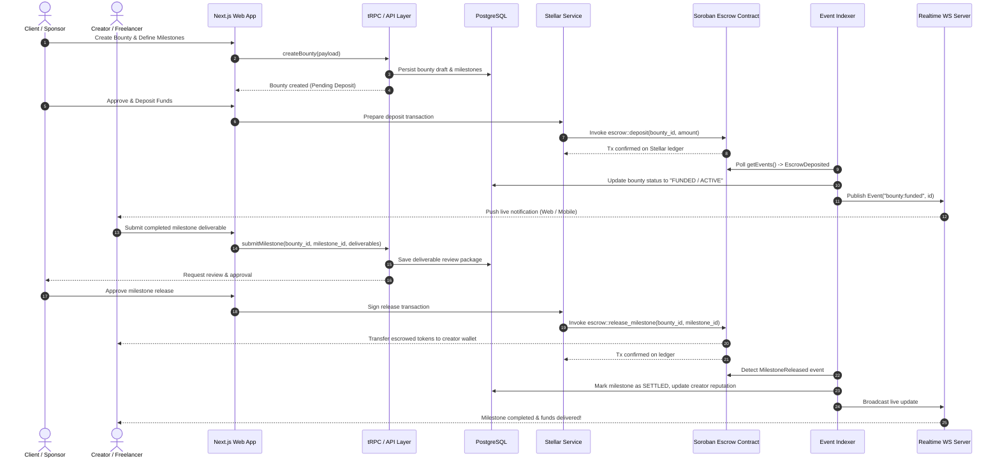
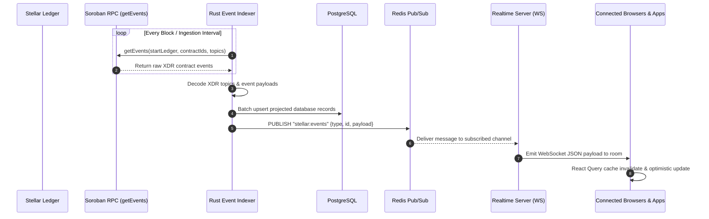

# Tamgora Platform Architecture Overview

This document provides a comprehensive architectural blueprint of the **Tamgora** platform (Stellar Creator Portfolio). It maps out the distributed subsystems, client applications, API layers, Rust microservices, Soroban smart contracts, event indexing pipelines, and persistent data stores.

---

## 1. System Topology & Architectural Map

Tamgora is designed as a hybrid Web3 application pairing a high-productivity TypeScript full-stack layer (Next.js App Router, tRPC, GraphQL, WebSockets) with high-throughput Rust services and on-chain Soroban smart contracts on the [Stellar network](https://developers.stellar.org/docs/build/smart-contracts/overview).

```mermaid
flowchart TD
    subgraph Clients["1. Client Tier"]
        WEB["Next.js Web App<br/>(app/, React 19, Tailwind, shadcn/ui)"]
        MOBILE["Mobile App<br/>(mobile/, React Native / Expo)"]
        EXT["External Clients & Webhooks<br/>(Stripe, Sentry, Partners)"]
    end

    subgraph EdgeAPI["2. API Gateway & Application Server (server/ & app/api)"]
        TRPC["tRPC Router<br/>(server/api/)"]
        GQL["GraphQL Server<br/>(server/graphql/)"]
        REST_APP["Next.js Route Handlers<br/>(app/api/)"]
        WS["Realtime WS Servers<br/>(server/realtime/)"]
        STELLAR_SRV["Stellar Service & Sequence Mgr<br/>(server/stellar/)"]
    end

    subgraph RustServices["3. Rust High-Performance Services (backend/services/)"]
        RUST_API["Rust REST API<br/>(backend/services/api/)"]
        RUST_AUTH["Auth Service<br/>(backend/services/auth/)"]
        INDEXER["Soroban Event Indexer<br/>(backend/services/indexer/)"]
        NOTIF["Notification Engine<br/>(backend/services/notifications/)"]
        LIMIT["Rate Limiter Middleware<br/>(backend/limit/)"]
    end

    subgraph Blockchain["4. Smart Contracts on Stellar (backend/contracts/)"]
        BOUNTY["Bounty Contract<br/>(bounty/)"]
        ESCROW["Escrow Contract<br/>(escrow/)"]
        FREELANCER["Freelancer Registry<br/>(freelancer/)"]
        GOVERNANCE["Governance & Voting<br/>(governance/)"]
        IDENTITY["Identity & KYC<br/>(identity/)"]
        ORACLE["Price / Risk Oracle<br/>(oracle/)"]
    end

    subgraph Storage["5. Persistence & Infrastructure Tier"]
        PG[("PostgreSQL Database<br/>(Prisma ORM & SQL Migrations)")]
        REDIS[("Redis Cache & Pub/Sub<br/>(Rate Limits, Sessions, Locks)")]
        S3[("AWS S3 Storage<br/>(Media, Portfolio Assets)")]
        STELLAR_NET[("Stellar Ledger & Soroban RPC<br/>(Testnet / Mainnet)")]
        OBS["Observability & Telemetry<br/>(OpenTelemetry, Prometheus, Grafana)"]
    end

    %% Client connections
    WEB -->|tRPC / React Query| TRPC
    WEB -->|GraphQL Queries| GQL
    WEB -->|HTTP Mutations / Auth| REST_APP
    WEB <-->|WebSockets (Collab & Feeds)| WS
    MOBILE -->|REST / GraphQL| GQL
    MOBILE -->|REST API| RUST_API
    EXT -->|Webhooks| REST_APP

    %% Application Server internals
    TRPC --> PG
    TRPC --> REDIS
    GQL --> PG
    GQL --> REDIS
    REST_APP --> PG
    REST_APP --> S3
    REST_APP --> STELLAR_SRV
    WS <--> REDIS

    %% Rust services internals
    RUST_API --> LIMIT
    LIMIT --> REDIS
    RUST_API --> PG
    RUST_AUTH --> PG
    INDEXER -->|Soroban getEvents| STELLAR_NET
    INDEXER -->|Upsert Projected State| PG
    INDEXER -->|Publish Updates| REDIS
    NOTIF --> PG

    %% Stellar contracts interaction
    STELLAR_SRV -->|Submit Tx & Simulate| STELLAR_NET
    STELLAR_NET --- BOUNTY
    STELLAR_NET --- ESCROW
    STELLAR_NET --- FREELANCER
    STELLAR_NET --- GOVERNANCE
    STELLAR_NET --- IDENTITY
    STELLAR_NET --- ORACLE

    %% Observability
    EdgeAPI -.-> OBS
    RustServices -.-> OBS
```

---

## 2. Core Subsystems & Responsibilities

### 2.1. Client Applications
* **Next.js Web Application (`app/`, `components/`, `hooks/`)**:
  * Built on Next.js 16 (App Router) using React 19, Tailwind CSS v4, and shadcn/ui.
  * Server Components handle initial data fetching; Client Components manage interactive forms, wallet connections (Freighter, Albedo, Stellar Wallets Kit), and real-time live feeds.
* **Mobile Application (`mobile/`)**:
  * React Native / Expo application targeting iOS and Android for on-the-go bounty alerts, portfolio updates, and push notifications.

### 2.2. TypeScript Application & API Layer (`server/` & `app/api/`)
* **tRPC Gateway (`server/api/`)**:
  * Provides end-to-end type safety between client queries and backend database logic. Handles creator profiles, review submissions, and bounty workflows.
* **GraphQL Engine (`server/graphql/`)**:
  * Provides flexible query shapes for rich discovery surfaces, search filters, and portfolio feeds. Hardened against denial-of-service via depth limiting and cost analysis according to [GraphQL security best practices](https://graphql.org/learn/security/).
* **Realtime Server (`server/realtime/`)**:
  * Standalone WebSocket servers managing collaborative editor signaling, presence detection, and live bounty status broadcasts via Redis Pub/Sub.
* **Stellar Integration & Sequence Manager (`server/stellar/`)**:
  * Manages Horizon and Soroban RPC connections, transaction envelopes, fee estimation, account sequence queuing, and contract invocation simulations.

### 2.3. Rust Microservices (`backend/services/`)
* **REST API Service (`backend/services/api/`)**:
  * High-performance Actix-web API handling high-throughput endpoints, analytics ingestion, and mobile client routes.
* **Soroban Event Indexer (`backend/services/indexer/`)**:
  * Continuous worker polling the [Soroban RPC `getEvents`](https://developers.stellar.org/docs/data/apis/rpc/api-reference/methods/getEvents) endpoint.
  * Normalizes contract events (bounty deposits, milestone releases, disputes), writes projected read models into PostgreSQL, and publishes update notifications to Redis channels.
* **Rate Limiter & Traffic Guard (`backend/limit/`)**:
  * Distributed token bucket and sliding window rate-limiter backed by Redis to safeguard public endpoints against abuse.
* **Notification Engine (`backend/services/notifications/`)**:
  * Dispatches transactional emails (SES/SendGrid) and mobile push notifications when on-chain bounty state transitions occur.

### 2.4. Smart Contracts Layer (`backend/contracts/`)
> [!IMPORTANT]
> The canonical contracts live in `backend/contracts/` (managed by the `backend/Cargo.toml` workspace and deployed via `.github/workflows/deploy-contracts.yml`). The top-level `contracts/` directory contains legacy/scaffold code pending archival.

* **Bounty (`backend/contracts/bounty`)**: Lifecycle management of bounties, application submissions, milestone tracking, and dispute state machines.
* **Escrow (`backend/contracts/escrow`)**: Milestone-locked funds custody, timelock validation, and multi-party release authorisation.
* **Freelancer Registry (`backend/contracts/freelancer`)**: Verifiable creator credentials, ratings, and portfolio verification hashes.
* **Governance (`backend/contracts/governance`)**: On-chain voting and proposal management for protocol parameters.
* **Identity (`backend/contracts/identity`)**: Decentralized KYC verification records and cryptographic attestation links.
* **Oracle (`backend/contracts/oracle`)**: External price feed integration and off-chain data validation.

### 2.5. Storage & Persistence Tier
* **PostgreSQL (via Prisma ORM & SQL Migrations)**:
  * Primary system of record for off-chain relational data: user profiles, rich portfolio markdown/media metadata, application drafts, audit logs, and indexed on-chain events.
* **Redis**:
  * Distributed cache, session revocation store, rate-limiting counters, account sequence mutex locks, and realtime pub/sub event bus.
* **AWS S3**:
  * Encrypted object storage for portfolio media, attachments, resume documents, and creator video assets.
* **Stellar Network**:
  * Immutable decentralized ledger storing smart contract state, escrow token balances, and transaction event logs.

---

## 3. End-to-End Data Flows

### 3.1. Bounty Escrow & Milestone Release Flow

The diagram below details the multi-step lifecycle of creating, escrowing funds, submitting milestones, and on-chain settlement:



---

### 3.2. Soroban Event Ingestion & Realtime Sync



---

## 4. Security, Networking & Deployment Topology

### 4.1. Security Architecture
* **Non-Custodial Escrow**: Funds are held directly by audited Soroban smart contracts on the Stellar network. Neither the platform backend nor third-party intermediaries can seize funds without contract dispute arbitration.
* **Authentication & Authorization**:
  * User authentication is handled via NextAuth.js supporting Web3 Stellar wallet signatures (SEP-10 challenge-response transaction protocol) and OAuth providers.
  * Role-based access control (RBAC) separates Creator, Client, Reviewer, and Admin privileges.
* **Rate Limiting & Threat Prevention**:
  * Edge rate limiting via `backend/limit` prevents endpoint exhaustion.
  * Strict CORS policies, Content Security Policy (CSP), and SQL parameterization via Prisma eliminate injection risks.

### 4.2. Observability & Telemetry
* **Tracing**: OpenTelemetry SDK instruments both Next.js server routes and Actix-web services, exporting traces via OTLP gRPC.
* **Metrics**: Prometheus scrapes service endpoints; Grafana dashboards visualize API latencies, queue depths, and indexer lag (`backend/grafana/`).
* **Error Tracking**: Sentry captures client-side exceptions and unhandled server rejections with source maps.

### 4.3. Continuous Deployment
* **Contract Deployments**: `.github/workflows/deploy-contracts.yml` compiles canonical contracts using the `wasm32v1-none` target, runs automated unit tests, and deploys artifacts to Stellar Testnet.
* **Web & Services**: Packaged via multi-stage Dockerfiles (`Dockerfile`, `Dockerfile.app`, `backend/Dockerfile.api`) and deployable to standalone container environments, Kubernetes clusters (`helm/`), or serverless edge infrastructure.

---

## 5. Architectural References & External Standards

* [Stellar & Soroban Smart Contracts Documentation](https://developers.stellar.org/docs/build/smart-contracts/overview)
* [Soroban RPC getEvents API Specification](https://developers.stellar.org/docs/data/apis/rpc/api-reference/methods/getEvents)
* [Stellar SEP-0010: Web3 Authentication Protocol](https://github.com/stellar/stellar-protocol/blob/master/ecosystem/sep-0010.md)
* [GraphQL Security Best Practices (Depth & Cost Limiting)](https://graphql.org/learn/security/)
